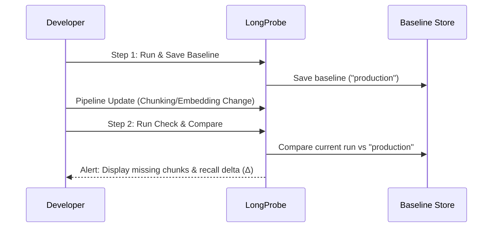

# Detect RAG Regressions Over Time

The **Detect Regressions** demonstration shows how to establish a baseline snapshot of your RAG pipeline and automatically detect retrieval regressions whenever chunking, embeddings, or documents change.

---

## Overview

A **retrieval regression** occurs when a modification to your RAG pipeline (such as changing `chunk_size`, updating vector database indexes, or removing documents) causes the vector store to fail to retrieve ground-truth chunks that previously succeeded.

LongProbe's baseline tracking allows you to save named baselines (e.g. `production-v1`), run tests after making changes, and generate detailed regression reports highlighting exact lost chunks.

---

## Running the Demo

To run the regression detection demo locally:

```bash
uv run python demo_run/detect_regressions.py
```

---

## Two-Step Baseline Comparison Workflow

The regression detection workflow consists of two core steps:



---

## Historical demonstration output

The recording below illustrates an older run, not acceptance evidence for v0.2.0. Current baseline promotion requires every evaluated approved question to pass by default. An unchanged average alone does not establish passing quality or deployment readiness. See the [current release behavior](../releases/v0.2.0.md).

When executed, LongProbe displays the baseline creation and comparison progress:

```text
📊 Baseline Tracking - Detect RAG Regressions

╭──────────────────────────────────────────────────────────────────────────────────────────────────╮
│ ✓ Setup complete                                                                                 │
│                                                                                                  │
│   STEP 1                       ✓                  Baseline established - Recall: 83.3%           │
│   STEP 2                       ✓                  Comparison complete - Recall: 83.3%            │
╰──────────────────────────────────────────────────────────────────────────────────────────────────╯

╭───────────────────────────────────── 📈 BASELINE COMPARISON ─────────────────────────────────────╮
│ ✓ No regressions detected                                                                        │
│                                                                                                  │
│ ➡️ Unchanged: 3 questions                                                                        │
╰──────────────────────────────────────────────────────────────────────────────────────────────────╯

✅ Safe to deploy - no regressions detected!
```

---

## Code Example: Saving & Comparing Baselines

```python
from longprobe import LongProbe

# adapter is your application-owned retriever adapter.
probe = LongProbe(
    adapter=adapter,
    goldens_path="goldens.yaml",
    config_path="longprobe.yaml",
)

# After reviewing the golden evidence, evaluate and explicitly promote.
initial_report = probe.run()
probe.save_baseline(label="production-v1")

# After a pipeline update, require the selected reference.
new_report = probe.run(baseline_label="production-v1")
if new_report.quality["passed"]:
    print("Retrieval quality checks passed for this golden suite.")
else:
    print(new_report.quality["reasons"])
    print(new_report.comparison)
```

---

## Command Line Interface (CLI) Baseline Workflow

You can manage baselines directly from your terminal:

```bash
# Save baseline snapshot
uv run longprobe baseline save --label production-v1

# List all saved baselines
uv run longprobe baseline list

# Compare current pipeline against saved baseline
uv run longprobe diff --baseline production-v1
```
